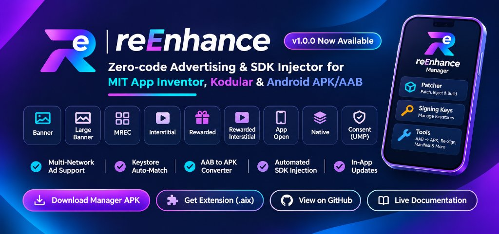

# reEnhance

  

  <strong>Easy Real Ads for MIT App Inventor, Kodular & Android Apps — Zero Coding Required</strong>

  
  
  
  
  

  🌐 <strong>Official Interactive Website & Quick-Start Guide:</strong> 
  👉 <a href="https://v5ati5h.github.io/reEnhance/"><strong>https://v5ati5h.github.io/reEnhance/</strong></a> 👈

---

## ✨ What is reEnhance?

**reEnhance** makes it simple and effortless to add real, working advertisements to your apps created with **MIT App Inventor**, **Kodular**, and other App Inventor builders.

Normally, adding ads to App Inventor apps leads to missing library errors, broken builds, or crashes. Updating an existing app often causes Android to show "App not installed" or "Package conflict" errors because the digital signing keys don't match.

**reEnhance fixes all of this with one tap on your Android phone:**
- ⚡ **Real Working Ads**: Connects your app directly to Google AdMob, Unity, AppLovin, and 15+ more ad networks with zero crashes.
- 🔄 **Update Without Reinstalling**: Remembers your App Inventor signing key so every updated app installs smoothly over the old one without losing user data.
- 🛡️ **Automatic Permissions**: Automatically adds internet and ad permissions behind the scenes—no manual XML or settings editing needed.
- 📱 **Easy Phone Testing**: Turn Google Play App Bundles (`.aab`) into regular installable apps (`.apk`) with one click to test on your phone.
- 🎯 **All Major Ad Formats**: Small Banners, Large Banners, Medium Rectangles (MREC), Fullscreen Interstitials, Rewarded Videos, and App Open ads.
- 🚀 **One-Tap App Updates**: reEnhance Manager checks for updates automatically and updates itself in-app.

---

## 📥 Downloads

| Component | Format | What It Is | Download |
|---|---|---|---|
| **reEnhance Manager** | `.apk` | The Android app on your phone that enhances, signs, and installs your apps | [**Download Latest Manager APK**](https://github.com/V5ati5h/reEnhance/releases/latest) |
| **reEnhance Extension** | `.aix` | The companion extension you drag into your App Inventor or Kodular project | [**Download Latest Extension (.aix)**](https://github.com/V5ati5h/reEnhance/releases/latest) |
| **reEnhance Demo Project** | `.aia` | Complete ready-to-run demo project with all blocks and splash screen set up | [**Download Demo Project (.aia)**](extension/reEnhance-demo.aia) |

---

## 🚀 Quick Start Guide (4 Easy Steps)

### Step 1: Add the Extension to App Inventor
1. Download `dev.v5ati5h.reenhance.aix` from [Releases](https://github.com/V5ati5h/reEnhance/releases).
2. Open your project on **MIT App Inventor** or **Kodular**.
3. Under **Palette > Extension**, click **Import extension** and choose the `.aix` file.
4. Drag the `reEnhance` component onto your Screen.

### Step 2: Snap Your Ad Blocks
In the Blocks editor, snap whichever ad blocks you want to use:
- `ShowBanner(container, placement)` — Shows a banner inside any Horizontal or Vertical Arrangement.
- `ShowInterstitial(placement)` — Shows a full-screen ad between screens or levels.
- `ShowRewarded(placement)` — Plays a video ad that rewards users with coins, lives, or points.
- `HideAds()` — Hides and clears visible banners when leaving a screen.

### Step 3: Export Your App
In App Inventor, click **Build > Android App (.apk)** or **Android App Bundle (.aab)** to download your app file.

### Step 4: Enhance & Install on Your Phone
1. Open the **reEnhance Manager** app on your Android phone.
2. Tap **Pick APK or AAB to patch** and choose your exported app file.
3. Tap **Build Signed APK**. reEnhance automatically prepares the ad networks and signs your app.
4. Tap **Install** to immediately test your live ads!

---

## 🛠️ reEnhance Manager Tabs

- **📦 Patcher**: Pick your app, check which ad blocks you used, tap Enhance, and install directly.
- **🔑 Signing Keys**: Save your App Inventor keystore once. reEnhance matches it automatically so every update installs smoothly.
- **🛠️ Tools**: Convert `.aab` bundles to `.apk`, re-sign apps, inspect ad settings, and test safely with built-in Test Mode.

---

## 🌐 Supported Ad Networks

reEnhance supports over 18 top ad networks:

| Network | Category | Ad Formats Supported |
|---|---|---|
| **Google AdMob** | Major Network | Banner, Large Banner, MREC, Interstitial, Rewarded Video, App Open, Native, Consent Form (UMP) |
| **Google Ad Manager** | Major Network | Banner, Large Banner, MREC, Interstitial, Rewarded Video, App Open, Native |
| **AppLovin (MAX)** | Mediation & Ads | Banner, Large Banner, MREC, Interstitial, Rewarded Video, App Open |
| **Unity Ads** | Gaming & Video | Banner, Interstitial, Rewarded Video |
| **IronSource (LevelPlay)** | Mediation & Video | Banner, Interstitial, Rewarded Video |
| **Meta (Facebook)** | Social & Display | Banner, Medium Rectangle, Interstitial, Rewarded Video |
| **StartApp (Start.io)** | Mobile Ads | Banner, MREC, Interstitial, Rewarded Video, App Open |
| **Mintegral** | Mobile Ads | Banner, Interstitial, Rewarded Video, App Open |
| **Pangle** | TikTok Ad Network | Banner, Interstitial, Rewarded Video, App Open |
| **InMobi** | Global Network | Banner, Interstitial, Rewarded Video |
| **Chartboost** | Gaming Ads | Banner, Interstitial, Rewarded Video |
| **Fyber** | Video & Mediation | Banner, Interstitial, Rewarded Video |
| **Vungle (Liftoff)** | Video Ads | Banner, MREC, Interstitial, Rewarded Video |
| **Offerwalls & Surveys** | Rewards & Tasks | CPA Lead, Tapjoy, AdGate Media, AdMantum, Pollfish, BitLabs, RapidoReach, TheoremReach |

---

## 📄 License

reEnhance is free, open source, and distributed under the [Apache License 2.0](LICENSE).  
Created with ❤️ by [Satish Vishwakarma](https://github.com/V5ati5h). Not affiliated with Google or MIT.
