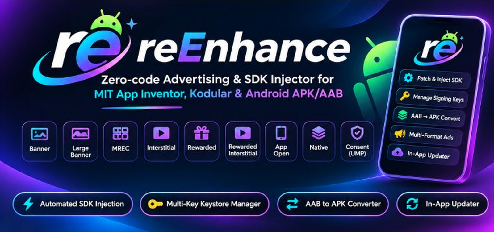

# reEnhance

<p align="center">
  
</p>

<p align="center">
  <strong>Zero-code Advertising & SDK Injector for MIT App Inventor, Kodular & Android APK/AAB packages</strong>
</p>

<p align="center">
  <a href="https://v5ati5h.github.io/reEnhance/"></a>
  <a href="https://github.com/V5ati5h/reEnhance/releases/latest"></a>
  <a href="https://github.com/V5ati5h/reEnhance/releases"></a>
  
  
</p>

<p align="center">
  🌐 <strong>Official Interactive Documentation & Blocks Guide:</strong><br/>
  👉 <a href="https://v5ati5h.github.io/reEnhance/"><strong>https://v5ati5h.github.io/reEnhance/</strong></a> 👈
</p>

---

## ⚡ What is reEnhance?

**reEnhance** is an all-in-one suite designed to bring enterprise-grade advertising capabilities to low-code Android applications created with **MIT App Inventor**, **Kodular**, and other App Inventor distributions.

Normally, App Inventor APKs cannot run real AdMob ads without complex workarounds, manual component hacking, or facing "SDK missing" crashes. When you try to update your app with a patched version, Android often blocks installation with a package conflict because the signing certificate changed.

**reEnhance solves all of this automatically on your Android device:**
- 📦 **Automated SDK Bytecode Injection**: Injects real Google Mobile Ads SDK classes (`classesN.dex`) and merged manifest components into your APK without requiring you to manually install SDKs in App Inventor.
- 🔑 **Multi-Key Keystore Manager**: Store your App Inventor `android.keystore`, custom `.jks`, or `.p12` keys. reEnhance reads the original signature and **auto-selects the matching key** so updates install directly over your existing app.
- 🔄 **AAB to APK Converter**: Convert Play App Bundles (`.aab`) into standalone signed `.apk` files ready for instant sideloading or distribution.
- 🎯 **Multi-Format Ad Support**: Banner (320x50), Large Banner (320x100), MREC (300x250), Interstitial, Rewarded Video, Rewarded Interstitial, App Open, and Google UMP Consent.
- 🚀 **In-App Updater**: Receive automatic update notifications and download the latest version directly from GitHub Releases — no Google Play Store required.

---

## 📥 Downloads

| Component | Format | Description | Download |
|---|---|---|---|
| **reEnhance Manager** | `.apk` | The Android app that inspects, patches, signs, and manages your APK/AAB files | [**Download Latest APK**](https://github.com/V5ati5h/reEnhance/releases/latest) |
| **reEnhance Extension** | `.aix` | The MIT App Inventor / Kodular companion extension for your project | [**Download Latest AIX**](https://github.com/V5ati5h/reEnhance/releases/latest) |

---

## 🚀 Quick Start Guide

### Step 1: Add the Extension to App Inventor
1. Download `dev.v5ati5h.reenhance.aix` from [Releases](https://github.com/V5ati5h/reEnhance/releases).
2. Open your project on **MIT App Inventor** or **Kodular**.
3. Under **Palette > Extension**, click **Import extension** and select the `.aix` file.
4. Drag and drop the `reEnhance` component onto your Screen.

### Step 2: Add Ad Blocks
In the Blocks editor, call any of the ad methods you need:
- `ShowBanner(layout, placement)` — Shows a standard 320x50 banner in a layout container.
- `ShowInterstitial(placement)` — Displays a fullscreen interstitial ad.
- `ShowRewarded(placement)` — Shows a rewarded video ad and fires the reward callback.
- `HideAds()` — Dismisses all visible inline ads.

### Step 3: Export your APK or AAB
In App Inventor, click **Build > Android App (.apk)** or **Android App Bundle (.aab)** and download the built file.

### Step 4: Patch & Sign with reEnhance Manager
1. Open the **reEnhance Manager** app on your phone.
2. In the **Patcher** tab, tap **Pick APK or AAB to patch** and choose your exported file.
3. **Automatic Scan**: reEnhance automatically detects which ad blocks and networks you used.
4. **Signing Key**:
   - If you have saved your App Inventor `android.keystore`, reEnhance detects the matching signature and selects it automatically.
   - If not, go to the **Signing Keys** tab to import your keystore or generate a new one.
5. **Review & Build**: Tap **Build Signed APK**.
   - reEnhance injects the necessary Google Mobile Ads SDK bytecode.
   - Adds required permissions (`INTERNET`, `ACCESS_NETWORK_STATE`, `AD_ID`) and metadata (`APPLICATION_ID`).
   - Signs the APK with your key using v1, v2, and v3 signing schemes.
6. **Install or Share**: Tap **Install** to upgrade your app in place, or **Share** / **Save** the output.

---

## 🛠️ App Features & Overview

```
 ┌──────────────────────────────────────────────────────────────┐
 │                     reEnhance Manager                        │
 ├───────────────────┬──────────────────────┬───────────────────┤
 │    📦 Patcher     │   🔑 Signing Keys    │     🛠️ Tools      │
 ├───────────────────┴──────────────────────┴───────────────────┤
 │ • 4-Step Guided Wizard                   • AAB → APK Tool    │
 │ • Block & Placement Auto-Detection       • Re-Sign Tool      │
 │ • SDK Bytecode & Multidex Injection      • Config Export/Imp │
 │ • Signature Auto-Matching                • SDK DEX Cache     │
 │ • Patch History & Instant Rebuilds       • GitHub In-App Upd │
 └──────────────────────────────────────────────────────────────┘
```

### 1. 📦 Patcher Tab
- **Session Persistence**: Keep your selected package active across tab switches.
- **DEX Code Inspector**: Scans classes and bytecode for reEnhance ad calls, formats, and placement IDs.
- **Patch History**: View past patches, inspect build sizes, export ad configuration JSON, and re-install previous builds with one click.

### 2. 🔑 Signing Keys Tab
- Store multiple keystores (`.keystore`, `.jks`, `.p12`).
- Shows SHA-1, SHA-256 fingerprint, key alias, and expiry date.
- **Auto-Match Engine**: When an APK is selected, reEnhance reads its original signature certificate SHA-256 and matches it to your stored keys. This guarantees the patched APK can update over the original app without "Package Conflict" errors.

### 3. 🛠️ Tools Tab
- **AAB → APK Standalone Converter**: Turn any Google Play App Bundle into an installable signed APK using Android bundle tools.
- **Re-Sign Package**: Re-sign APKs or AABs with your own key without modifying any code.
- **Ad Config Import / Export**: Save ad configurations (placements, IDs, waterfall priorities) to JSON and reuse them across builds.
- **SDK Cache Manager**: Ad SDK DEX files are cached in app storage for instant patching. Clear specific or all caches with one tap.
- **In-App Updater**: Checks GitHub Releases for new updates and downloads them securely in-app.

---

## 🌐 Supported Advertising Networks & Providers

reEnhance features a unified multi-network advertising engine with smart waterfall routing and placement overrides:

| Network / Provider | Category | Formats Supported | Integration Requirement |
|---|---|---|---|
| **Google AdMob** | Major Network | Banner, Large Banner, MREC, Interstitial, Rewarded, Rewarded Interstitial, App Open, Native, Consent Form (UMP) | Injected SDK bytecode + App ID |
| **Google Ad Manager (GAM)** | Major Network | Banner, Large Banner, MREC, Interstitial, Rewarded, Rewarded Interstitial, App Open, Native | Injected SDK bytecode + App ID |
| **AppLovin (MAX)** | Mediation & Ads | Banner, Large Banner, MREC, Interstitial, Rewarded, Rewarded Interstitial, App Open, Native | Injected SDK bytecode + SDK Key |
| **Meta Audience Network** | Social Ads | Banner, Large Banner, MREC, Interstitial, Rewarded, Native | Injected SDK bytecode + Placement ID |
| **Unity Ads & LevelPlay** | Gaming / Mediation | Banner, Large Banner, MREC, Interstitial, Rewarded, Native, Offerwall | Injected SDK bytecode + App Key / Game ID |
| **Mintegral** | Mobile Ads | Banner, Large Banner, MREC, Interstitial, Rewarded, Rewarded Interstitial, Splash | Injected SDK bytecode + App ID & Key |
| **Pangle (TikTok)** | Video Ads | Banner, Large Banner, MREC, Interstitial, Rewarded, Rewarded Interstitial, App Open, Native | Injected SDK bytecode + App ID |
| **Start.io** | Traditional Ads | Banner, Large Banner, MREC, Interstitial, Rewarded, Cover, Native | Injected SDK bytecode + App ID |
| **InMobi** | Global Network | Banner, Large Banner, MREC, Interstitial, Rewarded, Native, Instream | Injected SDK bytecode + Account ID |
| **AdColony** | Video Network | Banner, Interstitial, Rewarded | Injected SDK bytecode + App ID |
| **Chartboost** | Gaming Network | Banner, Interstitial, Rewarded | Injected SDK bytecode + App ID & Signature |
| **DT Exchange (Fyber)** | Programmatic | Banner, Interstitial, Rewarded | Injected SDK bytecode + App ID |
| **Leadbolt** | Traditional Ads | Banner, Interstitial, Rewarded, App Open | Injected SDK bytecode + API Key |
| **Pollfish** | Survey Network | Interactive Surveys & Feedback | Injected SDK bytecode + API Key |
| **TheoremReach** | Rewarded Surveys | Surveys & Rewarded Questionnaires | Injected SDK bytecode + API Key |
| **Wootric** | User Feedback | NPS / CSAT In-App Surveys | Injected SDK bytecode + Client ID |
| **RapidoReach & BitLabs** | Offerwalls & Surveys | Rewarded Surveys & Offerwalls | Injected SDK bytecode + App Token |
| **House Ads** | Custom Direct Ads | Banners, Interstitials, Custom HTML | Local JSON & image assets (zero SDK required) |

---

## 📡 Supported Ad Formats

| Format | Dimensions / Type | Description |
|---|---|---|
| **Banner** | 320 x 50 dp | Standard inline banner inside any arrangement |
| **Large Banner** | 320 x 100 dp | High-visibility inline banner |
| **MREC** | 300 x 250 dp | Medium Rectangle ad for content feeds |
| **Interstitial** | Fullscreen Static / Video | Fullscreen transition ad |
| **Rewarded** | Fullscreen Video | User-initiated ad offering in-app rewards |
| **Rewarded Interstitial** | Fullscreen Video | Non-skippable rewarded ad during natural breaks |
| **App Open** | Fullscreen | Displayed when the app is brought to foreground |
| **Native** | Custom UI Layout | Native card ad matching your app's look and feel |
| **Consent Form** | Dialog Overlay | Google UMP (User Messaging Platform) GDPR/CCPA dialog |
| **Offerwall & Surveys** | Web / Native Overlay | Rewarded surveys and tasks with user payout events |

---

## ❓ Frequently Asked Questions & Troubleshooting (FAQ)

#### Q: How does reEnhance prevent "com.google.android.gms.version" and "APPLICATION_ID" crashes?
**A**: Google Play Services and AdMob enforce strict manifest requirements:
- Google Play Services checks for `<meta-data android:name="com.google.android.gms.version" android:value="@integer/google_play_services_version" />`.
- AdMob checks for `<meta-data android:name="com.google.android.gms.ads.APPLICATION_ID" android:value="..." />`.

When building with App Inventor or Kodular, these tags are completely missing from the binary `AndroidManifest.xml`. **reEnhance solves this automatically with dual-layer protection:**
1. **Binary XML Engine (`AxmlTree`)**: Reconstructs the APK's binary manifest string pool and resource ID map, inserting the typed integer declaration `com.google.android.gms.version = 12451000` and the configured `APPLICATION_ID` into `<application>` without corrupting resources.
2. **Runtime Memory Guard**: Injects both values directly into `ApplicationInfo.metaData` before initializing the Google Mobile Ads SDK, guaranteeing that the SDK initializes smoothly without exceptions on any Android OS version.

#### Q: Why did Android say "App not installed as package appears to be invalid or conflicts with existing package"?
**A**: Android requires any update to an app to be signed with the **exact same key** as the version already installed.
To fix this:
1. Export your keystore from App Inventor: in the App Inventor menu, click **Projects > Export Keystore** to download `android.keystore` (default password is `android`, alias `androidkey`).
2. In reEnhance Manager, go to **Signing Keys > Add signing key > Import Keystore** and import `android.keystore`.
3. reEnhance will now auto-match this key for all your App Inventor apps, allowing direct in-place updates.

#### Q: Do I need to manually add the AdMob component in App Inventor?
**A**: **No!** You only need to import the `dev.v5ati5h.reenhance.aix` extension and use its blocks. reEnhance's patching engine automatically injects the compiled Google Mobile Ads SDK bytecode (`classesN.dex`) and required manifest entries during the patch process.

#### Q: Can I test ads without real AdMob account IDs?
**A**: Yes! reEnhance has a built-in **Test Mode**. When Test Mode is active, official Google sample ad units and test Application IDs (`ca-app-pub-3940256099942544~3347511713`) are automatically populated, allowing safe end-to-end testing without risking your AdMob account.

#### Q: Where are the SDK bundles loaded from?
**A**: Core SDK bundles (like Google Mobile Ads SDK) are included in the reEnhance Manager APK and cached locally in app storage. New and updated SDK bundles are dynamically loaded and verified from this public repository's [`sdk-bundles/`](sdk-bundles/) folder.

---

## 🔒 Security & Code Integrity

- **Open Distribution**: The public repository hosts compiled releases, documentation, and verified SDK bytecode bundles.
- **Source Privacy**: The source code for the patcher engine and extension is maintained in private repositories to protect proprietary logic and anti-tamper techniques.
- **Integrity Verification**: All distributed SDK DEX bundles include SHA-256 checksums in their bundle metadata and are verified before injection.

---

## 📄 License

reEnhance is distributed under the [Apache License 2.0](LICENSE).
Copyright © 2026 reEnhance Contributors.
